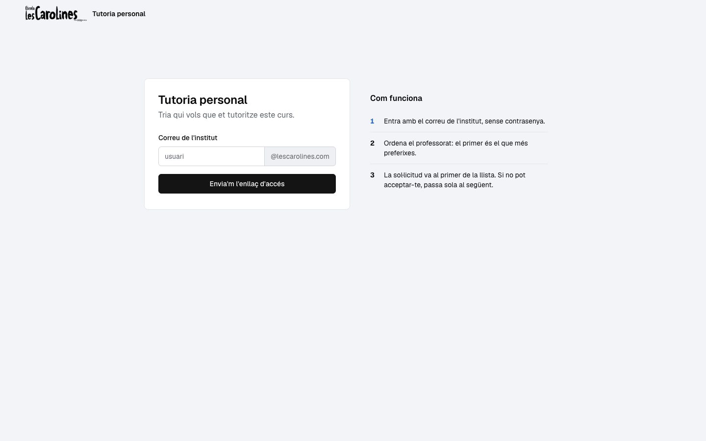
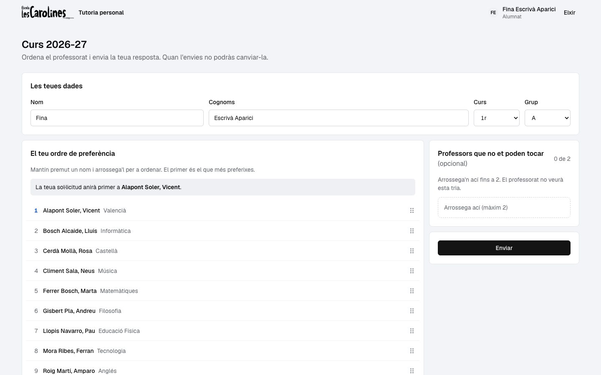
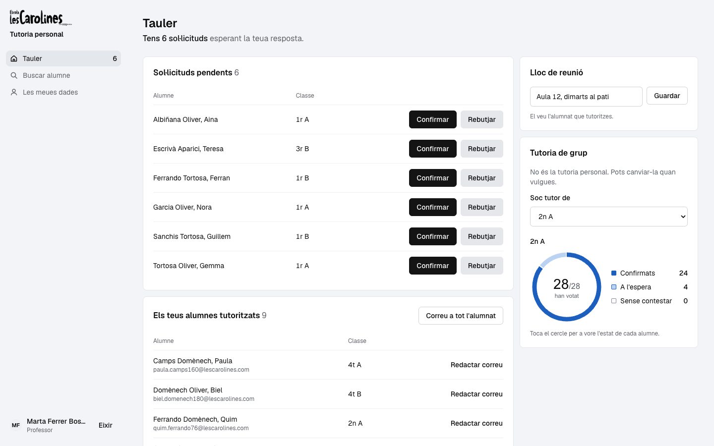
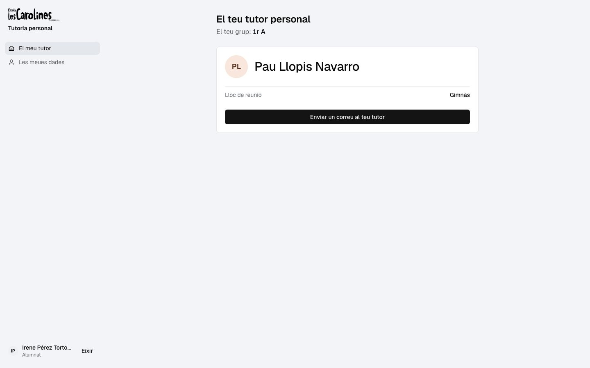
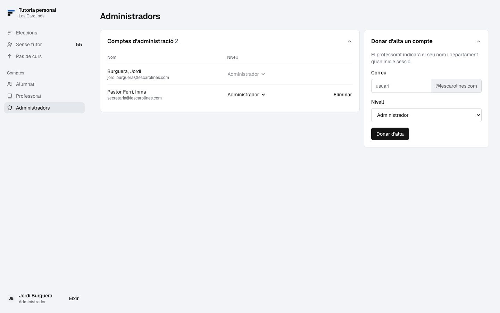
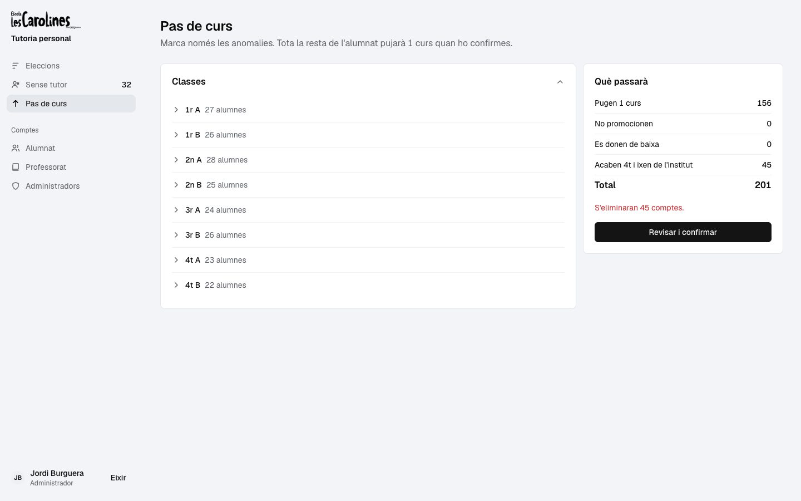
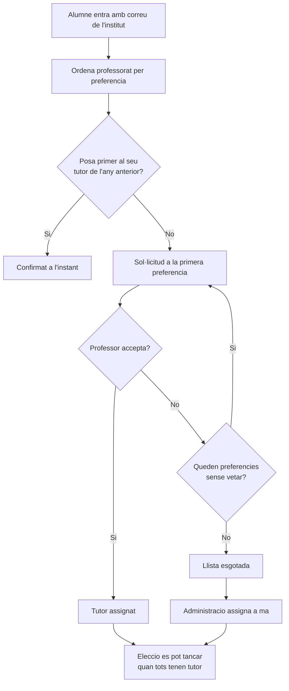
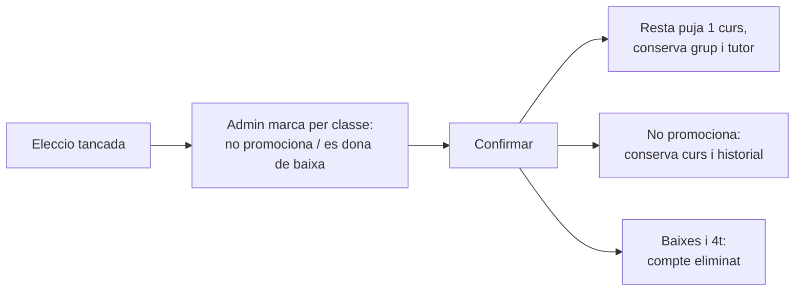

# 📋 Tutoria Personal — proposta a Digitalització

**Sistema web que substitueix el Google Form d'elecció de tutoria personal de Les Carolines**

<pre align="center">
&lt;/&gt; construït per alumnat, per a l'institut
</pre>

---

## Per a què serveix

El Google Form arreplega respostes, però no reparteix tutor a ningú: algú ha de creuar preferències a mà, parlar amb cada professor i mantindre la llista final.

**Tutoria Personal** automatitza tot el procés: l'alumnat ordena les seues preferències arrossegant, el sistema envia la sol·licitud en cascada fins que un professor l'accepta, i administració només intervé en els casos excepcionals.

Ja és un prototip funcional, provat amb dades d'exemple. El que demanem a Digitalització és que ens deixe donar-ho a conéixer i posar-ho en marxa per a l'institut.

---

## Captures

**Accés sense contrasenya, amb el correu de l'institut**

  

**L'alumnat ordena el professorat arrossegant**

  

**El professorat confirma o rebutja sol·licituds**

  

**L'alumnat veu el seu tutor assignat**

  

**Administració gestiona comptes**

  

**Pas de curs automatitzat al tancament de l'any**

---

## Flux de l'elecció

**Repetidors i pas de curs**, en tancar l'elecció:

---

## Funcionalitats principals

| Per a qui | Què fa |
|---|---|
| **Alumnat** | Entra sense contrasenya per enllaç al correu · ordena professorat arrossegant (ratolí i tàctil) · fins a 2 vetos opcionals · veu el tutor de l'any anterior · s'autoconfirma si el repeteix · consulta el seu tutor i lloc de reunió |
| **Professorat** | Accepta o rebutja sol·licituds · veu la seua llista d'alumnat tutoritzat · correu directe a un o a tots · defineix lloc de reunió · pot ser tutor de grup d'una o diverses classes, ho canvia quan vulga · mostra d'una ullada (donut) l'estat de la seua classe |
| **Administració** | Convoca i tanca eleccions · assigna tutor a mà a qui es va quedar sense cap · dona d'alta professorat i administració · gestiona comptes i rols · exporta PDF amb tutors, departaments i llocs de reunió · executa el *pas de curs* amb revisió abans de confirmar |
| **Sistema** | Recordatori diari automàtic (sense noms, només avís) · tot en temps real per WebSocket · base de dades SQLite amb migració automàtica · test suite d'extrem a extrem |

La llista completa (142 funcionalitats verificades una a una) està en [`SUMMARY.md`](SUMMARY.md).

---

## Stack tècnic

| Peça | Tecnologia |
|---|---|
| Backend | Node.js 22 + Express 5, sense framework pesat |
| Base de dades | SQLite (`node:sqlite`), un sol arxiu |
| Temps real | WebSocket natiu (`ws`) |
| Correu | Nodemailer sobre SMTP de Gmail |
| PDF | PDFKit, cartell A3 per tutor |
| Frontend | HTML, CSS i JavaScript sense dependències de build, amb SortableJS per a l'arrossegar |
| Tests | `node --test`, prova d'extrem a extrem de l'API |

Zero dependències de pagament. Tot programari lliure.

---

## Què necessitem de Digitalització

1. **Un apartat en la web de l'institut** per a presentar-lo i un lloc on allotjar-lo, per exemple `lescarolines.com/tutories-personals`.
2. **Un correu de l'institut** per als correus de verificació d'accés i els avisos (p. ex. `tutoria@lescarolines.com`), amb contrasenya d'aplicació habilitada per a enviar per SMTP.
3. **Revisió del valencià** de tota la interfície — li demanarem a Blanca que revise l'ortografia abans d'obrir-ho al centre.

> ⚠️ **Important per a la convocatòria d'eleccions**
>
> El sistema només compta com a "pendent de votar" qui ja té compte creat. Qui mai ha entrat no apareix en els gràfics ni bloqueja el tancament — "han votat tots" pot ser fals si falta algú per donar d'alta.
>
> Per això, **abans de cada convocatòria**, cada tutor de grup ha d'assegurar-se que tot el seu alumnat nou tinga correu de l'institut i compte de Tutoria Personal creat (n'hi ha prou que entren una vegada). Ho marcarem com a pas obligatori en el protocol de convocatòria.

---

## Continuar amb el desenvolupament

**1. CSV de l'alumnat.** Açò ve de la nostra idea d'un *cens d'alumnat*: que administració puga pujar abans de cada convocatòria un CSV amb correu, nom, curs i grup de tot l'alumnat. Resoldria que el sistema sàpia de veritat qui falta per votar, fins i tot qui encara no ha entrat mai, i evitaria altes manuals repetides cada curs.

Preguntem: **teniu alguna eina que ja traga un CSV així de Sèneca o d'un altre sistema del centre?** Si existeix un format ja fet, adaptem la nostra importació a eixe format en lloc de demanar-ne un de nou.

**2. Noms de tots els departaments.** Ara mateix tenim esta llista en el codi, probablement incompleta o desactualitzada:

| | | |
|---|---|---|
| Anglés | Biologia i Geologia | Castellà |
| Clàssiques | Economia | Educació Física |
| Educació Plàstica | Filosofia | Física i Química |
| Francés | Geografia i Història | Informàtica |
| Matemàtiques | Música | Orientació |
| Religió | Tecnologia | Valencià |

Ens podeu confirmar el llistat oficial i complet de departaments de l'institut?

---

## Suggeriment: sistema modular

Ja tenim la comunicació en temps real per WebSocket entre professorat i alumnat funcionant. Sobre eixa mateixa base es poden afegir altres mòduls de l'institut més avant (avisos, incidències, etc.) sense refer la infraestructura.

---

## Límits coneguts i què falta abans d'usar-ho de veritat

- **Dades de menors.** Hi ha noms de menors i vetos, informació delicada. L'institut ha de decidir quant de temps es guarden i validar-ho amb el seu responsable de protecció de dades. Proposem esborrar els vetos en tancar cada elecció.
- **Allotjament.** Fa falta un servidor amb HTTPS i còpies de seguretat de l'arxiu de base de dades.
- **Correu real.** L'enviament per Gmail està programat però encara no provat amb un compte real de l'institut.
- **Accés de prova.** Cal llevar `LOGIN_PRUEBA=1` de l'entorn abans d'obrir-ho a ningú més: amb eixa variable qualsevol entra sense correu, també com a administrador.
- **Prova pilot.** Proposem provar-ho primer amb un sol curs abans d'obrir-ho a tot l'institut.

---

**Ho demanem per a este curs 2026-27.** Està fet, provat i llest per a una prova pilot — només necessitem lloc, correu i el vostre vistiplau.

